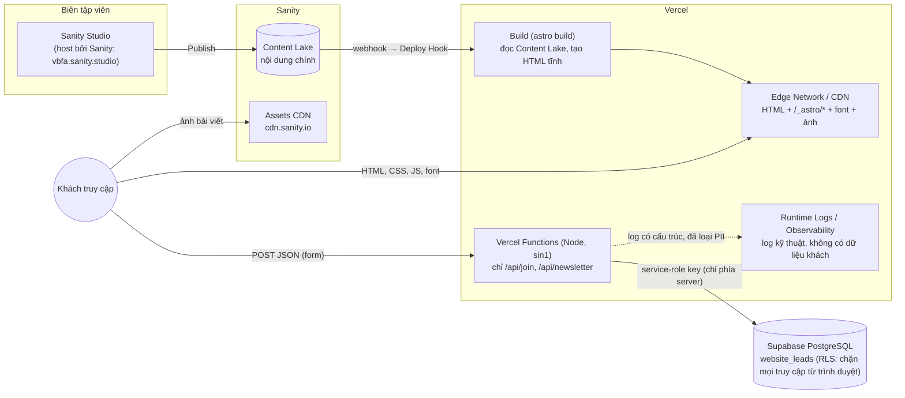

# Kiến trúc VBFA website

Frontend **Astro 7** (xuất tĩnh) triển khai trên **Vercel**, nội dung ở **Sanity**, dữ liệu khách ở **Supabase**.
Không dùng Next.js, WordPress hay máy chủ riêng.



## 1. Đối chiếu với bảng tech stack

| Thành phần | Điều chỉnh đề xuất | Triển khai trong repo |
|---|---|---|
| Vercel Edge Network | Phân biệt CDN và Functions | Mọi trang là HTML tĩnh dựng sẵn, phục vụ từ **CDN**. Chỉ `src/pages/api/**` đặt `prerender = false` và chạy thành **Vercel Function** (Node 24, `maxDuration` 10s, vùng `sin1` trong `vercel.json`). `/_astro/*` được cache `immutable` 1 năm. Header bảo mật + CSP áp dụng cho từng route (`astro.config.ts`, `vercel.json`). |
| Frontend Next.js / Astro | Chốt Astro | **Astro 7**, `output: 'static'` + `@astrojs/vercel`. Không có Next.js. Component hoá toàn bộ giao diện (`src/components`), CSS tách theo khối (`src/styles`), script TypeScript theo tính năng (`src/scripts`). |
| Sanity Studio | Ưu tiên hosting riêng tại Sanity | `studio/` là package độc lập, triển khai bằng `sanity deploy` lên `*.sanity.studio`. **Không** nhúng vào Vercel, không build cùng website. |
| Sanity Content Lake | Nguồn dữ liệu nội dung chính | Website đọc **lúc build** (`src/lib/content/load.ts`, GROQ ở `queries.ts`). Mọi tài liệu đi qua schema `zod`: tài liệu sai định dạng **làm hỏng build** nên bản đang chạy vẫn giữ nguyên. Không có Sanity thì dùng nội dung seed cục bộ (dev/preview). |
| Sanity Assets CDN | Phục vụ media trực tiếp cho trình duyệt | Trình duyệt tải ảnh thẳng từ `cdn.sanity.io` (`toMedia()` tạo `srcset` 400–1600px, `auto=format`, giữ crop/hotspot). CSP `img-src` chỉ cho phép `'self'` và `cdn.sanity.io`. Vercel không proxy ảnh. |
| Vercel API Routes | Form, bảo mật, tích hợp backend | `/api/join`, `/api/newsletter` → `src/lib/server/leads.ts`: kiểm tra Origin, kiểu nội dung, kích thước; honeypot + bẫy thời gian; zod; giới hạn tốc độ theo hash địa chỉ **tính mọi lượt thử** (kể cả không lưu); Turnstile cho cả hai form (nếu cấu hình); timeout 3 giây cho mỗi lệnh gọi Supabase/Turnstile; **fail-closed 503** khi thiếu cấu hình, thiếu `IP_HASH_SALT` hoặc chưa bật `LEADS_ENABLED`. |
| Supabase PostgreSQL | Chỉ dữ liệu nghiệp vụ và lead | Bảng `website_leads` (`0001_website_leads.sql`) và bộ đếm giới hạn `form_attempts` + hàm `register_attempt` (`0002_form_throttle.sql`; chỉ chứa hash địa chỉ, loại form, thời gian). RLS bật, **không có policy**, thu hồi quyền `anon/authenticated`: trình duyệt không đọc/ghi/gọi được. Ghi bằng service-role key chỉ ở Function. `purge_lead_metadata()` xoá hash địa chỉ trên lead sau 30 ngày và bộ đếm sau 2 ngày (lịch `pg_cron` hằng ngày nếu extension bật). |
| User Logs | Tách monitoring kỹ thuật khỏi dữ liệu khách | Xem mục 2. |
| SEO / Pop-up | Bổ sung vào mô hình CMS và frontend | Xem mục 4 và 5. |

## 2. Ranh giới dữ liệu (tách "log" khỏi "dữ liệu khách")

| Loại | Chứa gì | Ở đâu | Không bao giờ |
|---|---|---|---|
| **Dữ liệu nghiệp vụ / lead** | họ tên, tổ chức, email, điện thoại, nhu cầu, nội dung, bản đồng ý (phiên bản + thời điểm), nguồn trang, UTM | Supabase `website_leads` (đọc bằng dashboard/service role) | nằm trong log, analytics hay Sanity |
| **Monitoring kỹ thuật** | request id, tên sự kiện (`lead.stored`, `lead.rate_limited`…), mã trạng thái, thời gian xử lý, mã lỗi, loại form | stdout của Function → Vercel Runtime Logs / Log Drains / Observability | họ tên, email, điện thoại, nội dung, IP, token |
| **Phân tích truy cập** (tuỳ chọn) | lượt xem trang, hiệu năng thật (Web Vitals) | Vercel Web Analytics + Speed Insights (không cookie), bật bằng `ENABLE_VERCEL_ANALYTICS=true` | định danh cá nhân; không lưu hành vi từng người vào Supabase |
| **Nội dung** | bài viết, trang, cấu hình, pop-up | Sanity Content Lake | dữ liệu khách |

Cưỡng chế bằng code: `src/lib/server/log.ts` tự động che các khoá cá nhân/bí mật (`email`, `name`, `phone`, `message`, `ip`, `token`…), và test `leads.test.ts` kiểm tra rằng log của một lượt gửi thật **không chứa** email, tên, số điện thoại, nội dung hay IP. Địa chỉ IP chỉ tồn tại dưới dạng HMAC có muối (`ip_hash`) trong bảng lead để giới hạn tốc độ và bị xoá sau 30 ngày.

Chưa có "user event log" kiểu theo dõi hành vi. Nếu sau này cần (đo chuyển đổi, funnel), dùng công cụ analytics riêng và **không** ghi vào Supabase của lead.

## 3. Luồng dữ liệu

**Xuất bản nội dung**: biên tập viên *Publish* trong Studio → Sanity webhook gọi **Vercel Deploy Hook** → build chạy `astro build`, đọc Content Lake, kiểm tra bằng zod → HTML mới thay thế nguyên tử trên CDN (build lỗi thì bản cũ vẫn sống). Bài có `publishedAt` trong tương lai chỉ hiện sau lần build kế tiếp.

**Gửi biểu mẫu**:
1. Trình duyệt `POST application/json` tới `/api/join/` hoặc `/api/newsletter/` (cùng origin).
2. Function: phương thức → Origin → content-type → kích thước (≤ 8 KB) → honeypot/bẫy thời gian (bot nhận `200` giả, không lưu) → zod → cấu hình (thiếu Supabase, `IP_HASH_SALT` hoặc `LEADS_ENABLED` = `503`) → giới hạn tốc độ qua RPC `register_attempt` (một vòng gọi DB; mỗi 10 phút/địa chỉ tối đa 15 lượt thử và 5 lead đã lưu; địa chỉ không xác định dùng chung một ngân sách; kể cả lượt trùng/captcha sai) → Turnstile (cả hai form, nếu có khoá) → ghi DB (chỉ trả `200` sau khi ghi xong).
3. Đăng ký bản tin trùng email trả về giống hệt lần đầu (không lộ ai đã đăng ký).
4. Trình duyệt hiện toast thành công hoặc thông báo lỗi trong hộp thoại, giữ nguyên dữ liệu đã nhập.

## 4. Mô hình nội dung (Sanity ↔ `src/lib/content/schema.ts`)

| Loại | Dạng | Ghi chú |
|---|---|---|
| `siteSettings` | singleton | tên, thanh trên cùng, chân trang, dải bản tin, **biểu mẫu** (câu đồng ý + phiên bản, thông báo), SEO mặc định, liên hệ & mạng xã hội cho JSON-LD |
| `homePage` | singleton | hero, về hiệp hội, 6 lĩnh vực, 3 bài nổi bật (tham chiếu `article`), hội viên, thư viện |
| `newsPage` | singleton | tiêu đề/đoạn dẫn trang Tin tức |
| `article` | nhiều | chuyên mục, nhãn phụ, ngày, ảnh bìa (bắt buộc alt), nội dung Portable Text **giới hạn đúng thiết kế** (H2, danh sách, in đậm/nghiêng, link, hình, khối "Điểm chính") |
| `page` | nhiều | trang tĩnh (chính sách bảo mật…) tại `/<slug>/` |
| `popup` | nhiều | chiến dịch pop-up (mục 5) |
| `seo` | object dùng chung | tiêu đề, mô tả, canonical, ảnh OG, `noIndex` |

Chưa tạo `resource`, `event`, `partner`: guide thiết kế ghi các trang Thư viện/Hội viên/Liên hệ chưa được thiết kế. Thêm khi có thiết kế.

## 5. SEO và Pop-up

**SEO** (`src/lib/seo.ts`, `components/seo/Seo.astro`):
- Mỗi trang: `<title>`, mô tả, **canonical**, Open Graph, Twitter, `og:image` (CMS → ảnh bìa → `/og-default.png`), ngôn ngữ `vi_VN`.
- JSON-LD: `Organization`, `WebSite`, `NewsArticle` (bài viết), `BreadcrumbList`. Ghi chú: ký tự `<` được escape nên nội dung biên tập không thể phá thẻ script.
- Mọi loại nội dung đều có trường `seo` (ghi đè tiêu đề/mô tả/canonical/ảnh OG, hoặc `noIndex`).
- `sitemap.xml` sinh từ CMS (có `lastmod` thật, bỏ trang `noIndex`); `robots.txt` theo cờ.
- **Chặn index mặc định**: chừng nào `PUBLIC_SITE_INDEXING` chưa là `on`, mọi trang có `noindex,nofollow` và `robots.txt` là `Disallow: /`. Bật cờ này khi ra mắt chính thức.

**Pop-up** (`components/layout/Popup.astro`, `scripts/popup.ts`):
- Biên tập: bật/tắt, tiêu đề, nội dung, ảnh, nút (không / mở form hội viên / liên kết), trang hiển thị, kích hoạt (sau N giây / cuộn % / định rời trang), tần suất (phiên / ngày / tuần / 1 lần), khung giờ, độ ưu tiên.
- Vì trang là tĩnh, trình duyệt quyết định lúc hiện: kiểm tra khung giờ, giới hạn tần suất (lưu `localStorage`, gắn với *phiên bản* pop-up nên sửa và Publish lại sẽ hiện lại), **không ngắt** khi đang mở hộp thoại, đang gõ vào ô nhập hay tab ẩn. Mỗi lượt xem trang tối đa một pop-up.
- Dùng chung hệ hộp thoại (khoá cuộn, bẫy Tab, Esc, trả focus) nên đạt cùng mức truy cập với form.

## 6. Bảo mật

- **CSP** do Astro sinh (hash cho script/style của chính nó) và ghi thành header thật cho từng route: `default-src 'self'`; ảnh chỉ `self` + `cdn.sanity.io`; kết nối chỉ `self`; `frame-ancestors 'self'`; Turnstile được cho phép khi bật.
  - Adapter ghi `src` của route theo tên route (`/tin-tuc`, `/404`) trong khi Vercel khớp chính xác đường dẫn có dấu `/` cuối (`/tin-tuc/`) và trang 404 được trả bởi route bắt-tất-cả. `scripts/finalize-vercel-output.mjs` (chạy sau `astro build` trong `npm run build`, `vercel.json` đặt `buildCommand` tương ứng) chuẩn hoá các route này rồi **kiểm tra mọi trang đã dựng đều có CSP, nếu thiếu thì build thất bại**. `scripts/check_site.py` và `scripts/qa/serve.mjs` khớp route theo cùng ngữ nghĩa của Vercel.
- Header: `nosniff`, `Referrer-Policy`, `Permissions-Policy`, `X-Frame-Options`, HSTS (`vercel.json`).
- Bí mật chỉ ở biến môi trường Vercel và chỉ được Function đọc (`astro:env/server`, khai báo `secret`). Không có khoá nào có tiền tố `PUBLIC_` ngoài các giá trị công khai (project id Sanity, site key Turnstile).
- `security.checkOrigin` của Astro + kiểm tra Origin riêng trong handler.
- Dữ liệu CMS đi qua zod trước khi render; Portable Text chỉ cho phép các kiểu có trong thiết kế.

## 7. Hiệu năng và chuyển động

- Font tự host qua **Astro Fonts API**: WOFF2 (đã subset Latin + tiếng Việt), toàn bộ SIL OFL — Be Vietnam Pro, Mona Sans, Barlow Condensed (nhãn), Dancing Script (câu viết tay); fingerprint + `immutable`; preload các font quan trọng; font dự phòng tự canh số đo để tránh dịch chuyển bố cục. Font độc quyền SVN không được commit/phát hành (`scripts/check_site.py` chặn).
- Ảnh thương hiệu WebP (giọt hero 312 KB → 37 KB). Ảnh bài viết từ Sanity: `srcset` + `auto=format`.
- Hoạt ảnh chỉ dùng `transform`/`opacity`/`clip-path`; các hoạt ảnh vô hạn của hero **tạm dừng khi hero ra khỏi màn hình**; `prefers-reduced-motion` hiện nội dung ngay.
- Ngân sách kiểm trong `scripts/check_site.py` (ảnh ≤ 260 KB, HTML ≤ 120 KB, CSS ≤ 90 KB, JS ≤ 120 KB).

## 8. Cấu trúc thư mục

```
astro.config.ts        Astro + Vercel adapter, Fonts API, CSP, schema biến môi trường
vercel.json            framework, vùng Function, header
src/
  pages/               index, tin-tuc/, [slug] (trang tĩnh), 404, api/ (Functions), sitemap, robots, search-index
  layouts/BaseLayout   khung chung: head/SEO, header, footer, hộp thoại, script
  components/          ui/ layout/ home/ news/ article/ seo/
  lib/content/         schema (zod), seed, queries GROQ, loader Sanity, entry getContent()
  lib/server/          handler form, validation, store Supabase, turnstile, log, hash
  scripts/             TypeScript phía trình duyệt, theo tính năng
  styles/              CSS tách khối, giữ nguyên thứ tự cascade của bản thiết kế
  assets/              font, ảnh thương hiệu, ảnh seed (được fingerprint)
studio/                Sanity Studio (host riêng)
supabase/migrations/   SQL + test migration (PGlite)
scripts/               check_site.py, export-seed.mjs, build-fonts.mjs, qa/ (e2e, serve)
docs/                  tài liệu này + design/ (handoff gốc)
```

## 9. Quyết định và đánh đổi

- **Tĩnh + webhook thay vì SSR**: nhanh nhất và rẻ nhất, an toàn khi Sanity gián đoạn. Đánh đổi: nội dung cập nhật sau ~1 phút build. Nếu cần tức thời, bật ISR của adapter hoặc preview riêng.
- **Sitemap tự sinh** thay cho `@astrojs/sitemap`: để có `lastmod` thật và loại `noIndex` từ CMS.
- **Portable Text bị giới hạn** thay vì cho dùng tự do: bảo vệ thiết kế.
- **Turnstile tuỳ chọn nhưng phủ cả hai form**: widget bản tin ở chế độ `interaction-only` (vô hình trừ khi Cloudflare cần tương tác), nạp lười ở lần focus đầu tiên để script bên thứ ba không nằm trên đường găng; form hội viên nạp khi mở hộp thoại. Khi có `TURNSTILE_SECRET_KEY` server bắt buộc token cho cả hai.
- **Công tắc ra mắt `LEADS_ENABLED`**: việc thu thập dữ liệu cá nhân chỉ bật khi biến này là `true` (đặt sau khi chính sách bảo mật và câu đồng ý được duyệt), ngoài việc có khoá Supabase.
- **Chưa có email xác nhận** cho bản tin: cần nhà cung cấp email (Resend…) và quy trình double opt-in; hiện chỉ ghi nhận đăng ký (thông báo thành công đã viết đúng như vậy).
